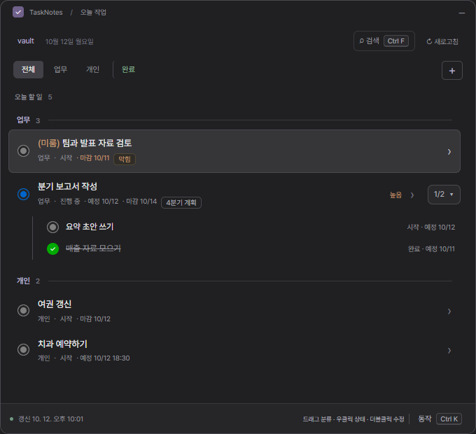
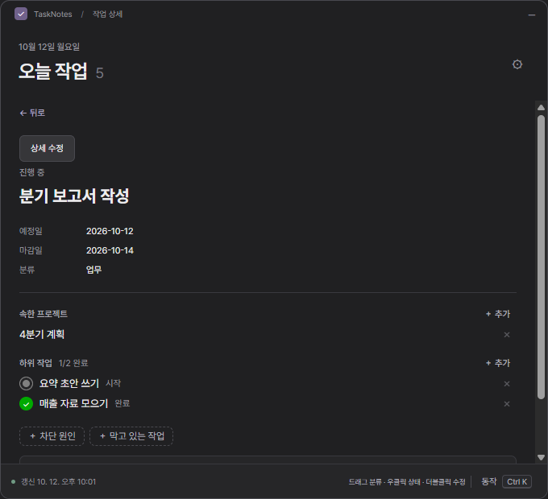
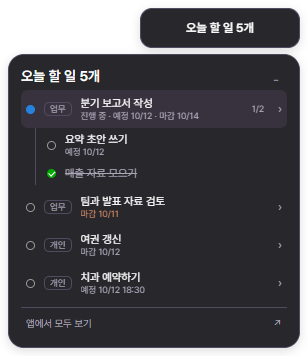

# Obsidian Task Manager

[English](README.md) · 한국어

로컬 Obsidian 볼트의 [TaskNotes](https://github.com/callumalpass/tasknotes) 작업을 다루는 작은 Windows 데스크톱 앱입니다. 단축키 하나로 오늘 할 일을 팝업으로 열고, 바탕화면의 미니 위젯으로 남은 개수를 확인하고, 상태·날짜·관계를 마우스로 바꿉니다. Markdown 파일을 직접 읽고 쓰므로 Obsidian을 켜 둘 필요가 없고, 어디로도 데이터를 보내지 않습니다.

> **상태:** 초기 버전입니다. 만든 사람이 매일 쓰고 있으며 Windows 11에서만 시험했습니다. Windows 설치 파일로 설치하거나 소스에서 실행합니다. 화면은 한국어와 영어를 지원합니다.
> Obsidian이나 TaskNotes와 관계가 없는 비공식 도구입니다.

## 왜 만들었나

요즘은 Obsidian에 할 일을 직접 입력하는 일이 거의 없습니다. AI에게 말하면 할 일을 등록하고 일정을 잡아 주고, 오늘 무엇을 해야 하는지 브리핑해 주는 흐름이 자연스러워졌기 때문입니다. 그러다 보니 제게 남은 일은 할 일을 **잘 보는 것**과 상태를 빠르게 바꾸는 것이었습니다.

그런데 TaskNotes는 Obsidian을 켜야 볼 수 있고, Obsidian은 전체 창으로 열리기 때문에 할 일 목록을 가볍게 확인하기 어려웠습니다. 그래서 Obsidian을 켜지 않아도 위젯처럼 할 일이 늘 보이고, 클릭 몇 번으로 상태를 바꿀 수 있는 앱을 만들었습니다. 할 일이 눈에 잘 보이면 생산성도 조금 더 높아지지 않을까 하는 생각에서 시작했습니다. 그래서 이 앱은 작업을 새로 만드는 일보다 **보고, 상태를 바꾸는 일**에 집중합니다.



| 프로젝트와 하위 작업이 보이는 작업 상세 | 미니 위젯 |
|---|---|
|  |  |

## 하는 일

- **단축키 팝업**(기본 Ctrl+Shift+Space, 변경 가능)과 트레이 아이콘. Ctrl+F로 모든 날짜의 작업을 검색합니다.
- **오늘 목록**: 예정일이나 마감일이 오늘 이전인 미완료 작업을 분류별로 보여줍니다. 마감일이 지난 작업에는 *(미룸)*이 붙습니다. **완료** 탭에서는 모든 날짜의 완료 작업을 보고 다시 열 수 있습니다.
- **마우스로 수정**: 우클릭으로 상태를 바꾸고, 더블클릭으로 상태·우선순위·예정일·마감일(시간 선택 가능)·본문을 고칩니다. 작업을 다른 분류로 드래그하면 분류가 바뀝니다.
- **관계**: 프로젝트, 하위 작업, 차단. 상위 작업에 `2/5`가 표시되고 누르면 하위 작업이 트리로 펼쳐지며, 막힌 작업은 따로 표시됩니다. 작업 상세에서 작업이나 노트의 이름을 입력해 추가·해제합니다. 파일을 고르지 않습니다.
- **미니 위젯**: 바탕화면에 "오늘 할 일 3개"를 항상 위에 표시합니다. 마우스를 올리면 목록이, 작업 위에 1초쯤 머물면 하위 작업이 보이고, 누르면 앱에서 열립니다. 드래그로 옮기고 우클릭으로 설정합니다.
- **설정**(Ctrl+K → 볼트 설정): 언어, 화이트·블랙 테마, 단축키, Windows 로그인 시 자동 시작, 작업 폴더, 선택 기능인 [Headless 동기화](#선택-옵시디언-없이-obsidian-sync-이어가기).

## 설치

Windows 10 또는 11과, TaskNotes 작업이 있는 Obsidian 볼트가 필요합니다. TaskNotes 플러그인을 켜 둘 필요는 없고, 볼트에 설정이 있으면 그 설정을 따릅니다.

1. [Releases](https://github.com/Sjin8801/obsidian-task-manager/releases/latest)에서 `Obsidian-Task-Manager-Setup-<버전>.exe`를 내려받아 실행합니다. 지금 Windows 계정에만 설치되며(관리자 권한 불필요) 설치가 끝나면 앱이 열립니다.
2. **"Windows의 PC 보호"** 창이 뜰 수 있습니다. 설치 파일에 코드 서명이 없어서입니다. **추가 정보 → 실행**을 누르세요.
3. 첫 화면에서 Obsidian 볼트 폴더를 선택합니다. 앱은 TaskNotes 설정의 작업 폴더를, 없으면 `TaskNotes/Tasks`를, 둘 다 없으면 볼트 전체를 읽습니다. 폴더는 나중에 볼트 설정에서 바꿀 수 있습니다.

## 매일 쓰기

- 시작 메뉴나 바탕화면 바로가기, 트레이 아이콘, 단축키로 엽니다.
- **자동 시작**(볼트 설정 → 자동 시작 → Windows 로그인 시 자동 시작): 다음 로그인부터 앱이 스스로 켜지고, 창은 숨긴 채 트레이와 위젯만 나타납니다.
- 창을 닫으면 숨겨질 뿐입니다. 종료는 트레이 아이콘 → 종료로 합니다.
- **업데이트**: 새 설치 파일을 내려받아 실행합니다. 설정은 그대로 남습니다.
- **삭제**: Windows 설정 → 앱 → 설치된 앱 → Obsidian Task Manager. 설정과 백업은 `%APPDATA%\Obsidian Task Manager`에 남으니, 함께 지우려면 그 폴더도 지우세요.

## 소스에서 실행하기

개발하거나, 배포 전 변경을 써 보려면 소스에서 실행합니다. [Node.js](https://nodejs.org) 24 이상과 [Git](https://git-scm.com)이 필요합니다.

```sh
git clone https://github.com/Sjin8801/obsidian-task-manager.git
cd obsidian-task-manager
npm ci
npm run desktop
```

처음 `npm ci`를 하면 Electron(약 100MB)을 내려받습니다. `npm run desktop`은 앱을 빌드하고 열며, 앱은 그 터미널이 열려 있는 동안만 실행됩니다. 터미널 없이 켜려면 자동 시작을 켜거나, 아래를 대상으로 하는 Windows 바로가기를 만드세요(폴더 경로는 본인 것으로).

```text
powershell.exe -NoProfile -ExecutionPolicy Bypass -WindowStyle Hidden -File "C:\path\to\obsidian-task-manager\scripts\launch-desktop.ps1"
```

업데이트는 트레이에서 앱을 종료한 뒤 `git pull`, `npm ci`, `npm run desktop` 순서로 합니다. 프로젝트 폴더를 옮겼다면 새 위치에서 자동 시작을 껐다가 다시 켜 주세요.

**설치판으로 옮기기**: 트레이에서 앱을 종료한 뒤 설치합니다. 자동 시작을 켜 두었다면 설치판이 처음 켜질 때 설정(볼트, 분류, 단축키, 위젯, 테마, 동기화)을 가져오고 자동 시작도 넘겨받습니다. 꺼 두었다면 볼트를 한 번 다시 선택하세요. 백업은 프로젝트 폴더에 그대로 남습니다.

## 작업을 찾고 보여주는 기준

- **어떤 노트가 작업인가**: TaskNotes의 규칙을 따릅니다. 기본은 `task` 태그가 있는 노트입니다(`task/…`도 포함). TaskNotes에서 태그 이름을 바꿨거나 속성으로 작업을 구분하도록 설정했다면 앱도 똑같이 합니다. 일반 `- [ ]` 체크박스는 작업으로 보지 않습니다.
- **속성 이름과 상태 목록**은 TaskNotes 설정(`.obsidian/plugins/tasknotes/data.json`)을 따릅니다. 설정이 없으면 TaskNotes 기본값(`status`, `priority`, `scheduled`, `due`, `completedDate` 등과 `none`/`open`/`in-progress`/`done`)을 씁니다. 한국어 속성(`상태`, `예정일`, `마감일` 등)과 다른 표기의 상태 값도 읽고, 이미 한국어 속성을 쓰는 노트에는 새 속성도 한국어로 추가합니다.
- **오늘**은 이 PC의 시간대 기준 날짜입니다. 시간대 없이 적힌 시각(TaskNotes가 쓰는 `2026-09-30T09:00` 형식)은 이 PC 시계의 시각으로 읽습니다.
- **분류는 태그입니다.** 기본 분류는 두 개입니다. *업무*는 `업무` 또는 `work` 태그가 있는 작업이고, *개인*은 나머지 전부입니다. 탭 줄의 ＋로 분류를 더 만들 수 있고, 각 분류는 같은 이름의 태그이며 볼트별로 저장됩니다. 작업을 다른 분류로 드래그하면 노트의 그 태그를 바꿉니다.

## 노트를 다루는 방식

- 작업 폴더 안의 노트만, 바꾼 속성만 씁니다. 주석, 다른 속성, 줄바꿈 형식, 본문은 그대로 둡니다.
- 쓰기 전에 원본을 앱 데이터 폴더(`task-backups`)에 복사합니다. 연 뒤에 다른 곳에서 노트가 바뀌었으면 덮어쓰지 않고 저장을 거부합니다. 쓴 뒤에는 다시 읽어 확인합니다.
- 반복 작업은 읽기만 합니다. 작업이 아닌 프로젝트 노트는 쓰지 않습니다.
- 날짜, `[[링크]]`, 관계는 [TaskNotes 규격](https://github.com/callumalpass/tasknotes-spec)을 따릅니다. 앱이 지원하는 것과 아닌 것은 [docs/tasknotes-reference.md](docs/tasknotes-reference.md)에 정리돼 있습니다.

## 앱 데이터 위치

설치판은 `%APPDATA%\Obsidian Task Manager`에, 소스 실행은 프로젝트 폴더 안의 `.local/desktop`에 저장합니다. 선택한 볼트, 설정, 그리고 노트를 고치기 전 원본을 담은 `task-backups`가 들어 있습니다. 백업은 자동으로 지우지 않습니다. 소스에서 실행할 때는 프로젝트 폴더를 지우거나 `git clean -fdx`를 실행하면 함께 지워집니다.

## 선택: 옵시디언 없이 Obsidian Sync 이어가기

Obsidian 앱을 끄면 Obsidian Sync도 멈춥니다. **볼트 설정 → 옵시디언 동기화 → Headless 동기화 실행**을 켜면 이 앱이 켜져 있는 동안 Obsidian 공식 [헤드리스 클라이언트](https://obsidian.md/help/sync/headless)(`obsidian-headless`, 오픈 베타)를 백그라운드에서 실행합니다. 기본값은 꺼짐입니다.

앱은 Obsidian 계정이나 암호화 비밀번호를 다루지 않습니다. 클라이언트 준비는 터미널에서 한 번만 합니다(설정 화면의 **처음 준비하는 방법**에 이 볼트의 경로가 채워진 같은 안내가 있습니다).

1. Obsidian Sync 구독이 필요합니다.
2. `npm install -g obsidian-headless`
3. `ob login`
4. `ob sync-list-remote`로 원격 볼트 이름을 확인한 뒤 `ob sync-setup --vault "원격 볼트 이름" --path "볼트 폴더 경로"`
5. **이 PC의 Obsidian 앱에서 Sync를 끕니다.** Obsidian은 같은 기기에서 앱 Sync와 헤드리스 Sync를 함께 쓰지 말라고 안내합니다. 다른 기기는 지금처럼 앱 Sync를 쓰면 됩니다.
6. **Headless 동기화 실행**을 켭니다.

상태(최신 상태, 동기화 중, 연결 끊김, 문제와 해결 방법)는 설정 화면과 트레이 툴팁에 나오고, 문제가 생기면 Windows 알림으로도 알립니다. 앱은 양방향(`bidirectional`) 모드일 때만 클라이언트를 시작하므로 이 앱에서 고친 내용이 버려지지 않습니다. 클라이언트를 찾지 못하면 `TASK_HEADLESS_ENTRY`에 `cli.js` 경로를(필요하면 `TASK_HEADLESS_NODE`에 `node.exe` 경로를) 지정합니다. 상태는 0.0.14 버전의 출력 문구를 읽어 판단하므로 이후 버전에서는 표시가 틀릴 수 있습니다. 동기화 자체에는 영향이 없습니다.

## 아직 지원하지 않는 것

작업 생성·삭제, 제목 변경, 반복 작업 수정, 알림, 시간 기록, 컨텍스트, 사용자 정의 필드. macOS와 Linux는 시험하지 않았습니다.

## 개발

```sh
npm run check              # 타입 검사와 단위 테스트. CI가 Windows에서 실행하는 것과 같습니다
npm run desktop:smoke      # 실제 Electron으로 본창을, 합성 볼트에서 시험
npm run desktop:pet-smoke  # 미니 위젯
npm run desktop:sync-smoke # Headless 동기화, 가짜 `ob`로(계정·네트워크 없음)
npm run docs:screenshots   # docs/images의 화면 사진
npm run dist               # 설치 파일, release/에 생성
npm run dist:smoke         # 설치 전 패키지 앱(release/win-unpacked) 시험
```

`package.json`의 버전으로 `v0.2.0` 같은 태그를 푸시하면 GitHub Actions가 설치 파일을 빌드해 초안 릴리스에 올립니다. 초안은 직접 확인한 뒤 공개합니다.

스모크 테스트와 화면 사진 촬영은 실제 창을 띄우고 키보드 포커스를 가져가므로 도는 동안 PC를 만지지 마세요. 임시 프로필의 합성 노트만 쓰고 사용자 볼트는 건드리지 않습니다. CI에서는 실행하지 않습니다.

구조: `packages/`에는 Electron 없이 TaskNotes 규칙(노트 읽기, 날짜, 링크, 관계, 변경)이 있고, `apps/desktop/`에는 Electron 메인 프로세스와 React 화면이 있습니다. 설계 메모는 [docs/](docs/)에 있습니다.

### 번역

화면·트레이·알림의 모든 문구는 **한국어 원문을 키로** `t('…')`를 거치고, `apps/desktop/i18n/en.ts`에 각각의 영어가 있습니다. 영어가 빠졌거나 쓰이지 않는 영어가 남으면 `npm test`가 실패합니다. 언어를 추가하려면 `en.ts` 같은 표를 만들고 `apps/desktop/i18n/index.ts`에 `Locale`과 `languageNames`의 이름을 더합니다.

## 라이선스

[MIT](LICENSE)
