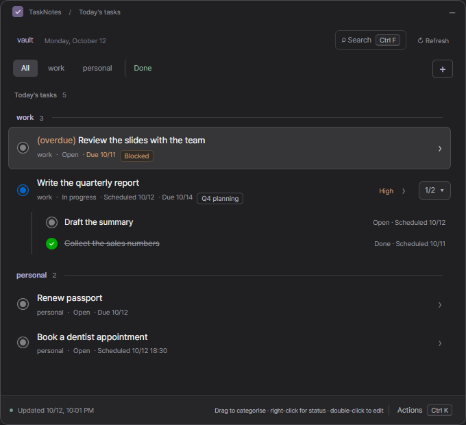
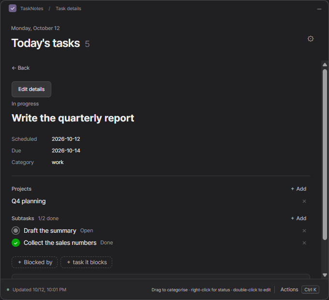
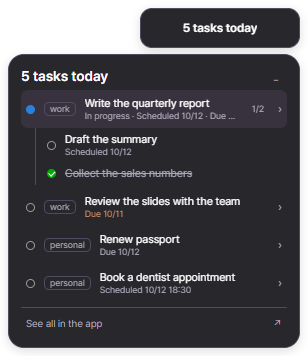

# Obsidian Task Manager

English · [한국어](README.ko.md)

A small Windows desktop app for the [TaskNotes](https://github.com/callumalpass/tasknotes) tasks in a local Obsidian vault. Today's tasks are one shortcut away in a popup, a mini widget on the desktop shows how many are left, and you change status, dates and relationships with the mouse. The app reads and writes the Markdown files directly: Obsidian does not have to be running, and nothing is sent anywhere.

> **Status:** early, used daily by its author, tested on Windows 11 only. It comes as a Windows installer, or runs from source. The screens are in English and Korean.
> Not affiliated with Obsidian or TaskNotes.

## Why

I hardly type tasks into Obsidian any more. An AI assistant adds them, schedules them and tells me each morning what today holds, and that has become the normal way of working. What is left for me is to **see** my tasks easily and change their status quickly.

TaskNotes, though, needs Obsidian open, and Obsidian is a full window: not a quick way to glance at a to-do list. So I built an app that keeps the tasks in view like a widget, without Obsidian, and changes a status in a click or two, on the thought that tasks that are easy to see are easier to get done. That is why the app is about seeing tasks and moving them along, more than about creating them.



| Task detail with its project and subtasks | Mini widget |
|---|---|
|  |  |

## What it does

- **Popup on a shortcut** (Ctrl+Shift+Space, changeable) or from the tray icon. Ctrl+F searches tasks of every date.
- **Today's list**: unfinished tasks scheduled or due today or earlier, grouped by category. A task whose due date has passed is marked *(overdue)*. A **Done** tab lists finished tasks of every date, and you can reopen them there.
- **Edit with the mouse**: right-click a task for its status; double-click to edit status, priority, scheduled and due date (with an optional time) and the note text. Drag a task onto another category to move it.
- **Relationships**: projects, subtasks and blockers. A parent shows `2/5` and opens its subtasks as a tree; a blocked task is marked. In a task's detail you add or remove them by typing a task's or note's name, never by picking a file.
- **Mini widget**: "3 tasks today" on the desktop, always on top. Hover to see the list; rest on a task for a second to see its subtasks; click to open it in the app. Drag to move, right-click for options.
- **Settings** (Ctrl+K → Vault settings): language, light or dark theme, the shortcut, start with Windows, task folder, and an optional [headless sync](#optional-keep-obsidian-sync-running-without-obsidian).

## Install

You need Windows 10 or 11 and an Obsidian vault with TaskNotes tasks. The TaskNotes plugin does not have to be open; if its settings are in the vault the app follows them.

1. Download `Obsidian-Task-Manager-Setup-<version>.exe` from [Releases](https://github.com/Sjin8801/obsidian-task-manager/releases/latest) and run it. It installs for your Windows account only (no administrator rights needed) and opens the app.
2. Windows may say **"Windows protected your PC"**, because the installer is not code-signed. Choose **More info → Run anyway**.
3. On the first screen choose your Obsidian vault folder. The app reads the tasks in the task folder of your TaskNotes settings, or `TaskNotes/Tasks`, or, if neither exists, the whole vault. You can change the folder later in Vault settings.

## Everyday use

- Open the app from the Start menu or the desktop shortcut, the tray icon, or the shortcut key.
- **Start with Windows** (Vault settings → Start with Windows): from your next sign-in the app starts by itself, hidden in the tray with the widget showing.
- Closing the window only hides it. To quit, use the tray icon → Quit.
- **Updating**: download the newer installer and run it. Your settings stay.
- **Uninstalling**: Windows Settings → Apps → Installed apps → Obsidian Task Manager. Your settings and backups stay in `%APPDATA%\Obsidian Task Manager`; delete that folder to remove them too.

## Run from source instead

For development, or to try a change before it is released. You need [Node.js](https://nodejs.org) 24 or newer and [Git](https://git-scm.com).

```sh
git clone https://github.com/Sjin8801/obsidian-task-manager.git
cd obsidian-task-manager
npm ci
npm run desktop
```

`npm ci` downloads Electron (about 100 MB) the first time. `npm run desktop` builds the app and opens it, and the app runs as long as that terminal stays open. To start it without a terminal, turn on Start with Windows, or make a Windows shortcut with this target (use your own folder):

```text
powershell.exe -NoProfile -ExecutionPolicy Bypass -WindowStyle Hidden -File "C:\path\to\obsidian-task-manager\scripts\launch-desktop.ps1"
```

To update, quit the app from the tray, then `git pull`, `npm ci` and `npm run desktop`. If you move the project folder, turn Start with Windows off and on again from the new place.

**Moving to the installer**: quit the app from the tray, then install. If Start with Windows was on, the installed app's first run copies your settings (vault, categories, shortcut, widget, theme, sync) and takes over starting with Windows. Otherwise choose the vault once more. The backups stay in the project folder.

## How tasks are found and shown

- **Which notes are tasks**: the TaskNotes rule. By default a note with the `task` tag (`task/…` counts too). If you changed the tag, or set TaskNotes to identify tasks by a property, the app does the same. Plain `- [ ]` checkboxes are not tasks.
- **Property names and statuses** come from your TaskNotes settings (`.obsidian/plugins/tasknotes/data.json`). Without settings the app uses TaskNotes' defaults (`status`, `priority`, `scheduled`, `due`, `completedDate`, … and `none`/`open`/`in-progress`/`done`). Korean property names (`상태`, `예정일`, `마감일`, …) are read as well.
- **Today** is the date on this PC, in its time zone. A time written without a zone (`2026-09-30T09:00`, as TaskNotes writes it) is a time on this PC's clock.
- **Categories are tags.** There are always two: *work* (a task tagged `work` or `업무`) and *personal* (every other task). Add more with ＋ in the tab row; each is a tag of the same name, saved per vault. Dragging a task to another category swaps that tag in the note.

## How it treats your notes

- Only notes inside the task folder are written, and only the properties you changed. Comments, other properties, line endings and the note text stay as they were.
- Before every write the original is copied to the app's data folder (`task-backups`). The note is checked against the version you opened: if it was changed elsewhere in the meantime, the save is refused instead of overwriting. After writing, the note is read back.
- Repeating tasks are read-only. Project notes that are not tasks are never written.
- Dates, `[[links]]` and relationships follow the [TaskNotes spec](https://github.com/callumalpass/tasknotes-spec). What the app covers and what it does not is in [docs/tasknotes-reference.md](docs/tasknotes-reference.md) (in Korean).

## Where the app keeps its data

The installed app keeps it in `%APPDATA%\Obsidian Task Manager`; a run from source in `.local/desktop` inside the project folder. That is the chosen vault, your settings, and `task-backups` with a copy of each note before it was changed. The backups are never deleted automatically. When running from source, deleting the project folder, or running `git clean -fdx`, deletes them too.

## Optional: keep Obsidian Sync running without Obsidian

When Obsidian is closed, Obsidian Sync stops. With **Vault settings → Obsidian Sync → Run headless sync** the app runs Obsidian's official [headless client](https://obsidian.md/help/sync/headless) (`obsidian-headless`, open beta) in the background while it is open. It is off by default.

The app never handles your Obsidian account or encryption password. Set the client up once in a terminal (the settings screen shows the same steps with your vault's path filled in):

1. You need an Obsidian Sync subscription.
2. `npm install -g obsidian-headless`
3. `ob login`
4. `ob sync-list-remote`, then `ob sync-setup --vault "<remote vault name>" --path "<vault folder>"`
5. **Turn off Sync in the Obsidian app on this PC.** Obsidian warns against using the app's Sync and headless sync on the same device. Your other devices keep using the app's Sync.
6. Turn on **Run headless sync**.

The status (up to date, syncing, disconnected, a problem and how to fix it) shows in the settings, in the tray tooltip and, when there is a problem, as a Windows notification. The app only starts the client in two-way mode (`bidirectional`), so changes made here are never discarded. If the client cannot be found, set `TASK_HEADLESS_ENTRY` to the path of its `cli.js` (and `TASK_HEADLESS_NODE` to `node.exe` if needed). The status is read from the client's output as of version 0.0.14, so a later version could show it wrongly; syncing itself is not affected.

## Not supported yet

Creating and deleting tasks, renaming a task, editing repeating tasks, reminders, time tracking, contexts and custom fields. macOS and Linux are untested.

## Development

```sh
npm run check              # typecheck and unit tests; this is what CI runs, on Windows
npm run desktop:smoke      # the app window, with real Electron, on a made-up vault
npm run desktop:pet-smoke  # the mini widget
npm run desktop:sync-smoke # headless sync, against a fake `ob` (no account, no network)
npm run docs:screenshots   # the pictures in docs/images
npm run dist               # the installer, in release/
npm run dist:smoke         # the packaged app from release/win-unpacked, before installing
```

Pushing a tag like `v0.2.0` (the version in `package.json`) makes GitHub Actions build the installer and attach it to a draft release, which is published by hand.

The smoke tests and the screenshots open real windows and take the keyboard focus, so leave the PC alone while they run. They use made-up notes in a temporary profile and never touch your vault. They are not run in CI.

Where things are: `packages/` holds the TaskNotes rules (reading notes, dates, links, relationships, changes) without Electron; `apps/desktop/` is the Electron main process and the React screens; design notes are in [docs/](docs/).

### Translating

Every text on the screens, the tray and the notifications goes through `t('…')` with the **Korean text as the key**, and `apps/desktop/i18n/en.ts` holds the English for each. `npm test` fails if a text has no English or an English text is no longer used. To add a language, add a table like `en.ts`, a `Locale` in `apps/desktop/i18n/index.ts` and its name in `languageNames`.

## License

[MIT](LICENSE)
